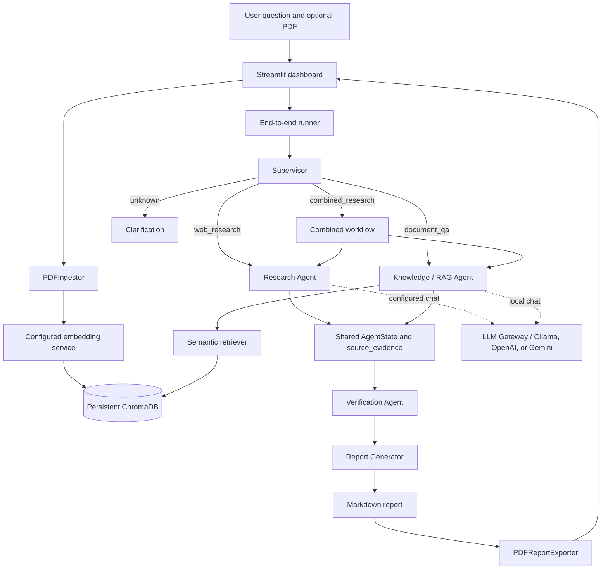

# 🚀 AgentX — AI Research Intelligence Platform

[](https://agentx-dxulc4ymi5cvkcz8y9emh6.streamlit.app/)

[](https://github.com/CodeHub010/AgentX)

An AI-powered multi-agent research assistant that combines web research, PDF analysis, RAG, evidence verification, and automated report generation.
# AgentX — Autonomous AI Research & Intelligence Platform

AgentX is a local-first research assistant that combines web-source synthesis and question answering over uploaded PDFs in one evidence-aware workflow. A Streamlit dashboard lets users submit a question, inspect the retrieved evidence and verification results, and download a generated Markdown report as PDF.

> **Project focus:** modular agents, traceable evidence, local inference, and explicit uncertainty.

## Problem

Research often involves gathering information from several sources, comparing it with existing documents, checking citations, and preparing a readable report. These steps can be time-consuming, and generated summaries can obscure whether their references actually support their claims.

AgentX brings those steps into a single workflow. It keeps retrieved web snippets and PDF passages with their source metadata, checks citations against available evidence, and marks unsupported, conflicting, or inconclusive findings. Its checks are deterministic and conservative; they are designed to make evidence easier to inspect, not to certify factual truth.

## Project objectives

- Route a question to web research, PDF question answering, or both.
- Reuse modular agents through a shared LangGraph state.
- Keep source text, citations, and document metadata available through verification and reporting.
- Run chat and embedding inference locally with Ollama by default.
- Produce a Markdown report and a downloadable PDF.
- Make incomplete evidence and runtime limitations visible to the user.

## Features

- **Multi-agent workflow:** focused Supervisor, Research, Knowledge/RAG, Verification, and Report Generator roles.
- **Supervisor and task routing:** deterministic query classification with conditional LangGraph routes.
- **Web research:** configurable demo fixtures by default, with an optional Tavily provider.
- **PDF knowledge retrieval:** page-aware extraction, chunking, provider-configurable embeddings, persistent ChromaDB storage, and semantic retrieval.
- **Evidence verification:** checks source references and compares claims with preserved source text; highlights unsupported, conflicting, and insufficient evidence.
- **Automated report generation:** deterministic Markdown assembly using findings and original source metadata.
- **PDF export:** renders the generated Markdown report through ReportLab.
- **Streamlit dashboard:** upload documents, select a research mode, inspect results, and download the report.
- **Local-first model use:** Ollama chat and embeddings remain the defaults and work without a cloud API key. OpenAI and Google Gemini are optional hosted providers. Models are never downloaded automatically by AgentX.

## Architecture



Web, Knowledge, and Combined routes proceed through verification and report generation. The clarification route returns a clarification status and does not generate a report. In combined mode, a failure in one agent does not discard the other agent's result.

## Agent responsibilities

| Agent / role | Responsibility |
|---|---|
| **Supervisor** | Classifies a question as web research, document QA, combined research, or unknown. It uses lightweight deterministic phrase cues and does not assume an uploaded document exists. |
| **Research Agent** | Queries the configured web search provider, uses the existing LLM Gateway to synthesize returned sources, and returns findings with numbered citations. |
| **Knowledge (RAG) Agent** | Embeds a question, retrieves relevant stored PDF chunks from ChromaDB, and asks the LLM Gateway for an answer grounded in those passages. |
| **Verification Agent** | Validates citation references and checks claims against cited web snippets or retrieved PDF text. It reports supported, unsupported, conflicting, or insufficient evidence. |
| **Report Generator** | Assembles a Markdown report from shared state, preserving the original source references and verification status. It does not call an LLM. |

The Combined workflow invokes the Research and Knowledge agents with the same question, then verification and reporting run on their shared evidence. PDF rendering is handled by the existing exporter rather than a separate agent.

## Technology stack

- Python 3.11 or 3.12
- LangChain and LangGraph
- Ollama with `llama3.2:1b` for chat and `nomic-embed-text` for embeddings by default
- Optional OpenAI and Google Gemini providers in the shared LLM Gateway and embedding service
- ChromaDB for persistent local document vectors
- PyMuPDF for PDF text extraction
- ReportLab for PDF report export
- Streamlit for the dashboard
- `httpx` for local embedding and Tavily HTTP calls
- Standard-library `unittest` for automated tests

The end-to-end runner uses `LLM_PROVIDER` for chat selection and `EMBEDDING_PROVIDER` for document and query embeddings. Both default to `ollama`; OpenAI requires `OPENAI_API_KEY`, while Gemini requires `GEMINI_API_KEY`. `OLLAMA_EMBEDDING_MODEL`, `OPENAI_EMBEDDING_MODEL`, and `GEMINI_EMBEDDING_MODEL` select each provider's embedding model. Ingestion and retrieval use the same configured service and model identity. ChromaDB stores provider/model metadata and isolates non-default provider/model pairs into separate collections, so vectors from one provider/model are never silently reused by another. Existing data in the default `agentx_pdf_chunks` collection remains available for `ollama` with `nomic-embed-text`.

## Repository structure

```text
AgentX/
├── app.py                         # Streamlit dashboard entry point
├── .env.example                   # Configuration template; no real credentials
├── requirements.txt
├── agentx/
│   ├── agents/                    # Research, RAG, verification, report agents
│   ├── core/                      # Settings, shared state, routing, workflow, runner
│   ├── embeddings/                # Ollama and OpenAI embedding providers
│   ├── ingestion/                 # PDF extraction and chunking
│   ├── llm/                       # Provider-neutral local/cloud chat gateway
│   ├── reports/                   # Markdown-to-PDF export
│   ├── retrieval/                 # Semantic PDF retrieval
│   ├── storage/                   # Persistent ChromaDB vector storage
│   ├── tools/                     # Demo and Tavily web search providers
│   ├── ui/                        # Testable Streamlit upload/index service
│   ├── analysis/                   # Package scaffold; CSV analysis not connected
│   └── api/                        # Package scaffold; no FastAPI app is wired
├── data/                          # Local ChromaDB and uploaded PDFs (git-ignored)
├── reports/generated/             # Generated Markdown and PDF reports
├── scripts/                       # Component and end-to-end demos
└── tests/                         # Unit and integration-boundary tests
```

## Windows installation and setup

Open PowerShell in the repository directory. Python 3.11 or 3.12 is recommended.

```powershell
py -3.12 -m venv .venv
.\.venv\Scripts\Activate.ps1
python -m pip install --upgrade pip
python -m pip install -r requirements.txt
Copy-Item .env.example .env
```

If PowerShell blocks virtual-environment activation, use the Python executable directly instead:

```powershell
.\.venv\Scripts\python.exe -m pip install -r requirements.txt
```

Keep `.env` private. It is ignored by Git. Leave optional provider credentials blank until you choose to configure that provider.

## Ollama installation and models

Install Ollama for Windows from [ollama.com/download](https://ollama.com/download), then open the Ollama application or start its service. Pull the two default local models:

```powershell
ollama pull llama3.2:1b
ollama pull nomic-embed-text
ollama list
```

AgentX uses the chat model for synthesis and the configured embedding model for indexing and retrieval. With the default Ollama configuration, pull the local models explicitly; AgentX does not download models. If `EMBEDDING_PROVIDER=openai`, Ollama is not required for embeddings, but `OPENAI_API_KEY` must be set. On an 8 GB computer, the Ollama default keeps local model use small and avoids loading multiple large chat models at once.

## Environment configuration

`.env.example` documents the settings. Copy it to `.env` and edit only what you need.

| Variable | Purpose | Default in template |
|---|---|---|
| `LLM_PROVIDER` | Shared gateway provider: `ollama`, `openai`, or `gemini` | `ollama` |
| `OLLAMA_BASE_URL` | Local Ollama endpoint | `http://localhost:11434` |
| `OLLAMA_MODEL` | Chat model | `llama3.2:1b` |
| `OLLAMA_EMBEDDING_MODEL` | Local Ollama PDF/query embedding model | `nomic-embed-text` |
| `OLLAMA_EMBEDDING_BATCH_SIZE` | Embedding batch size | `8` |
| `EMBEDDING_PROVIDER` | Embedding provider: `ollama`, `openai`, or `gemini` | `ollama` |
| `OPENAI_EMBEDDING_MODEL` | Hosted OpenAI PDF/query embedding model | `text-embedding-3-small` |
| `GEMINI_API_KEY` | Required when chat or embeddings select Gemini | blank |
| `GEMINI_MODEL` | Gemini chat model | `gemini-3.6-flash` |
| `GEMINI_EMBEDDING_MODEL` | Gemini PDF/query embedding model | `gemini-embedding-001` |
| `LLM_CONNECT_TIMEOUT_SECONDS` | Connection timeout | `10` |
| `LLM_REQUEST_TIMEOUT_SECONDS` | Request timeout | `120` |
| `WEB_SEARCH_PROVIDER` | `demo` or `tavily` | `demo` |
| `TAVILY_API_KEY` | Required only for configured Tavily live search | blank |
| `OPENAI_API_KEY` | Required when chat or embeddings select OpenAI | blank |
| `CHROMA_PERSIST_DIRECTORY` | Persistent document vector database | `./data/chroma` |
| `SQLITE_PATH` | Reserved application setting | `./data/agentx.sqlite3` |

Demo web search is the default. Set `WEB_SEARCH_PROVIDER=tavily` and provide your own `TAVILY_API_KEY` to request live search. The application labels demo search output as demo data. Live search is not claimed unless a configured request has actually succeeded.

For a hosted Gemini setup, set `LLM_PROVIDER=gemini`, `EMBEDDING_PROVIDER=gemini`, and provide `GEMINI_API_KEY`. `GEMINI_MODEL` selects chat and `GEMINI_EMBEDDING_MODEL` selects the shared upload/query embedding model. In Streamlit Community Cloud, enter these as top-level secrets (for example `GEMINI_API_KEY = "..."`); Streamlit exposes top-level secrets through environment variables. Keep `.streamlit/secrets.toml` local and untracked. Local ChromaDB and uploaded files are not guaranteed to persist on Community Cloud, so users may need to upload documents again after an app restart.

## Launch the Streamlit dashboard

From the repository root, with the virtual environment active and Ollama running:

```powershell
python -m streamlit run app.py
```

The dashboard opens in a browser. It offers **Web research**, **Document only**, and **Combined research** modes. Document modes accept a PDF upload or a document already indexed during the current browser session. Uploading extracts and chunks text, generates vectors with `EMBEDDING_PROVIDER`, and stores the chunks in persistent ChromaDB. The same PDF content hash reuses its document ID on re-upload.

### Example questions

- Web: `What are recent approaches to detecting network intrusions?`
- Document: `What methodology does this report use?`
- Combined: `Compare the report's CNN-LSTM approach with current web research.`

### Typical workflow

1. For the default local setup, start Ollama and confirm the configured local models are available with `ollama list`. OpenAI chat or embedding calls require a configured key and network access.
2. Launch the Streamlit app.
3. Enter a focused question and choose a mode.
4. For Document or Combined mode, upload a text-based PDF or select a document indexed in the current session.
5. Review route and agent status, the verification labels, and the preserved source snippets/references.
6. Read the generated Markdown report and download its PDF if useful.

Scanned PDFs without an embedded text layer are not OCR-processed. The dashboard's upload service limits PDFs to 50 MB.

## Reports and command-line workflow

The end-to-end runner can also run from PowerShell:

```powershell
python scripts/test_end_to_end.py --question "Compare recent CNN-LSTM research with the uploaded report." --document-id YOUR_STORED_DOCUMENT_ID
```

It validates the document ID against the configured ChromaDB, runs the workflow, and saves Markdown and PDF under `reports/generated/` by default. The configured Tavily provider is used only when available; otherwise the runner uses clearly labeled demo fixtures. For help with additional options:

```powershell
python scripts/test_end_to_end.py --help
```

## Tests

Run the full suite from the repository root:

```powershell
python -m unittest discover -s tests -v
python -m compileall -q agentx app.py scripts tests
```

**Latest verified test result for this repository state: 161 tests passed.** Provider tests mock OpenAI/Ollama calls and do not require a paid API. ChromaDB storage tests use isolated temporary databases. Running the unit suite does not prove live Tavily, OpenAI embeddings, or full Ollama inference works on another machine.

## Known limitations

- Web search uses demo fixtures unless Tavily is configured; live web research is not enabled by default.
- Verification is deterministic lexical matching with sentence alignment and a small wording alias map. It is not guaranteed semantic verification, entailment checking, source-quality assessment, or factual validation. Ambiguous evidence should be treated as inconclusive.
- Document indexing and retrieval require a persistent ChromaDB directory and the selected embedding provider. The default Ollama models must already be installed; OpenAI embeddings require `OPENAI_API_KEY` and network access.
- PDF extraction reads embedded text; OCR for scanned-image PDFs is not implemented.
- CSV analysis is not connected to the current workflow. `agentx/analysis/` is only a package scaffold.
- `agentx/api/` is only a package scaffold; the current user interface calls the existing backend directly through Streamlit.
- Markdown report assembly is deterministic and does not use an LLM to improve prose.

## Future improvements

- Add optional, well-calibrated semantic claim/evidence comparison with transparent uncertainty reporting.
- Add OCR as an opt-in PDF ingestion path for scanned documents.
- Implement CSV ingestion and analysis as a routed workflow capability.
- Add broader live-provider integration checks that can be enabled explicitly by developers.
- Improve report customization and export accessibility while preserving source provenance.
- Add an API layer if a separate client or deployment architecture becomes necessary.

## License

No license file is currently included. Add a license before distributing or reusing the project outside its intended context.
